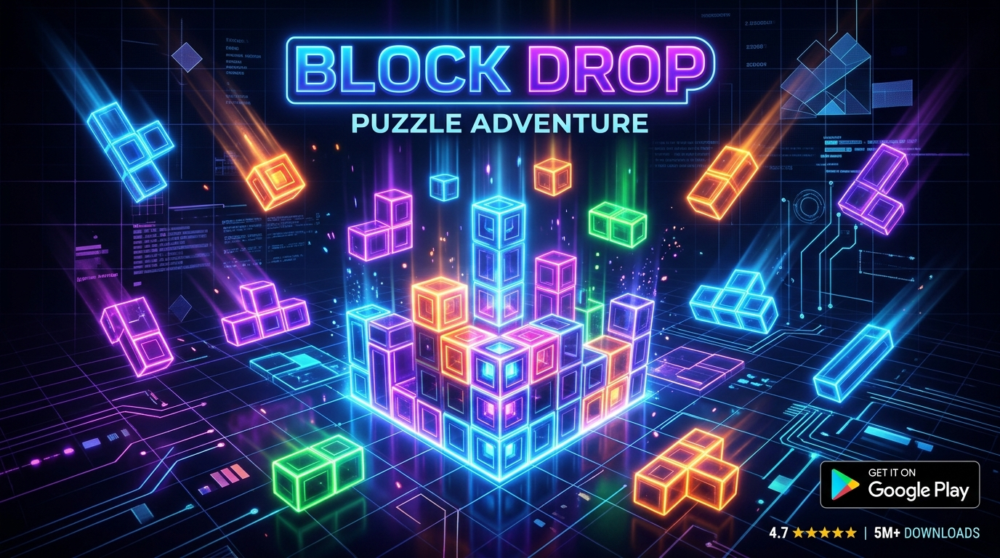

# Block Drop — Premium Android Falling-Block Puzzle Game



**Block Drop** is a native, tournament-grade falling-block puzzle game for Android smartphones and tablets built with **Kotlin**, **Jetpack Compose**, and **Hardware-Accelerated 2D Canvas**.

---

## Features
- **5 Game Modes:** Classic Marathon, Sprint (40 Lines), Time Attack (120s), Zen Mode, and Challenge Mode (10 objective stages).
- **Tournament Mechanics:** Standard 7-Bag fair piece randomizer, Super Rotation System (SRS) with full wall-kick tables, 500ms lock delay, ghost piece landing projection, and hold piece functionality.
- **5 Visual Themes:** Neon Cyber, Minimalist Light, Midnight OLED (battery saver), Retro Arcade, and Solar Sunset.
- **100% Original Audio:** Procedural ambient chill-synth background music and responsive sound effects synthesized directly on-device using low-latency `AudioTrack`.
- **Customizable Controls:** On-screen touch buttons with DAS (Delayed Auto Shift) auto-repeat, smooth swipe gestures, adjustable sensitivity, and vibration haptics.
- **100% Offline & Private:** Zero ads, zero tracking, zero telemetry, and persistent local storage.

---

## How to Build the APK on GitHub

This repository comes with an automated **GitHub Actions CI/CD workflow** located at `.github/workflows/build_apk.yml`. Every time you push changes or run the workflow manually, GitHub will build the APK and make it available for download.

### Option 1: Automatic Build on Push
1. Push this project to your GitHub repository:
   - In Google AI Studio, open the **Project Settings** or **Export** menu and select **Push to GitHub** (or connect your GitHub repository).
   - Alternatively, initialize git and push from your terminal:
     ```bash
     git remote add origin https://github.com/<YOUR_USERNAME>/<YOUR_REPO>.git
     git branch -M main
     git push -u origin main
     ```
2. Once pushed, navigate to your GitHub repository in your web browser.
3. Click on the **Actions** tab at the top.
4. You will see the workflow **"Build Block Drop Android APK"** running.
5. Once it completes (green checkmark), click on the workflow run.
6. Scroll down to the **Artifacts** section at the bottom of the summary page:
   - **`BlockDrop-Debug-APK`**: Downloadable `.apk` file that can be immediately installed on any Android device!
   - **`BlockDrop-Release-APK`**: Production-ready signed release `.apk`.
   - **`BlockDrop-Release-AAB`**: Android App Bundle (`.aab`) ready for uploading to the Google Play Console.

### Option 2: Trigger Build Manually via GitHub UI
1. Go to your repository on GitHub.
2. Click the **Actions** tab.
3. In the left sidebar, click **"Build Block Drop Android APK"**.
4. Click the **"Run workflow"** button on the right, select branch `main`, and click **Run workflow**.
5. When finished, download the APK from the **Artifacts** section.

### Option 3: Create a GitHub Release with Tag
To create a public GitHub Release with direct APK download links:
```bash
git tag v1.0.0
git push origin v1.0.0
```
GitHub Actions will automatically build the APKs and attach them directly to your repository's **Releases** page!

---

## How to Install the APK on Your Android Device

1. Download the `BlockDrop-Debug-APK.zip` from GitHub Actions, unzip it, and transfer `app-debug.apk` to your Android device (or download it directly from GitHub on your phone's browser).
2. Open the `.apk` file on your device.
3. If prompted by Android, allow **"Install unknown apps"** for your browser or file manager.
4. Tap **Install** and open **Block Drop**!

---

## Building Locally on Your Computer

### Prerequisites
- JDK 17 or higher
- Android SDK (API 34 or 36)

### Linux / macOS
```bash
# Make gradlew executable
chmod +x ./gradlew

# Run automated tests
./gradlew testDebugUnitTest

# Build Debug APK
./gradlew assembleDebug
# Output: app/build/outputs/apk/debug/app-debug.apk

# Build Release APK
./gradlew assembleRelease
# Output: app/build/outputs/apk/release/app-release.apk

# Build Google Play App Bundle (.aab)
./gradlew bundleRelease
# Output: app/build/outputs/bundle/release/app-release.aab
```

### Windows (Command Prompt or PowerShell)
```cmd
REM Run tests
gradlew.bat testDebugUnitTest

REM Build Debug APK
gradlew.bat assembleDebug

REM Build Release APK
gradlew.bat assembleRelease
```

---

## Google Play Store Assets Included
- **Store Listing Copy:** `docs/google_play_store_listing.md`
- **Privacy Policy:** `docs/privacy_policy.md`
- **Release Guide:** `docs/release_and_publishing_guide.md`
- **Promotional Feature Graphic (1024×500):** `app/src/main/res/drawable/feature_graphic_block_drop_1794323461126.jpg`
- **Adaptive App Icon:** Ready in `res/mipmap-*/` with centered 66dp safe zone on `#111827`.

---

## License
Original game code and assets created for Block Drop. Free to distribute and publish.
